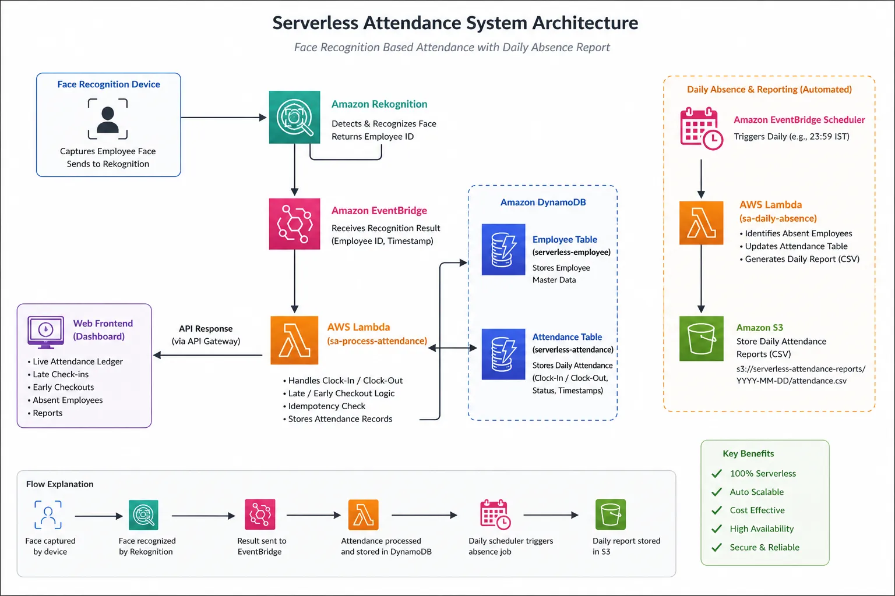
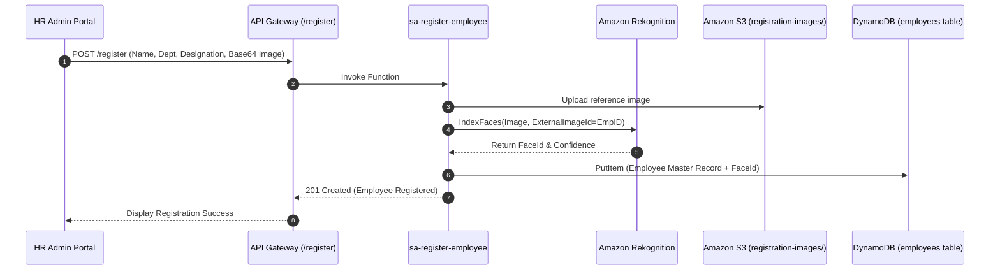
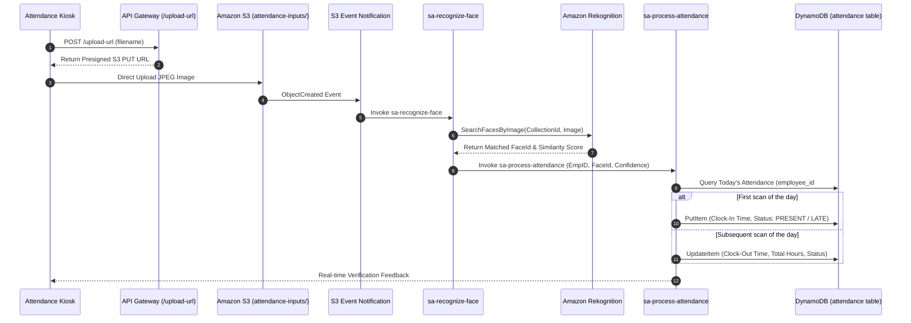
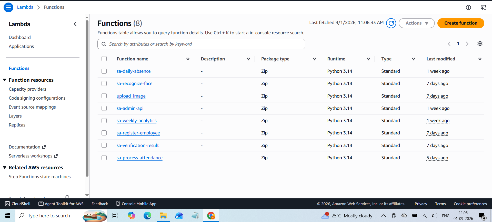
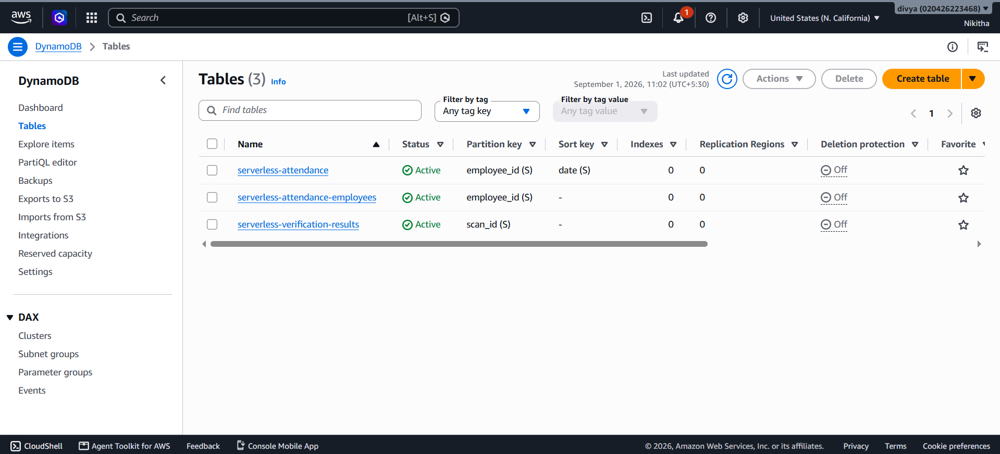
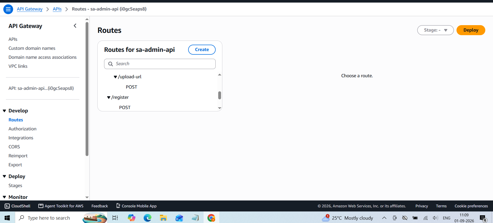
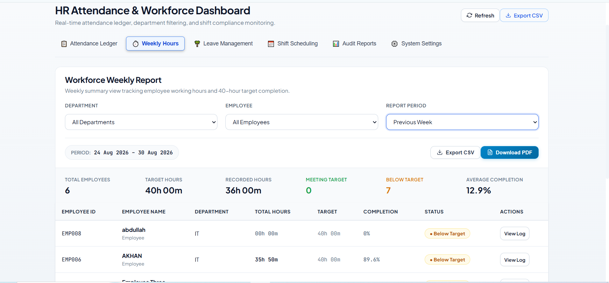
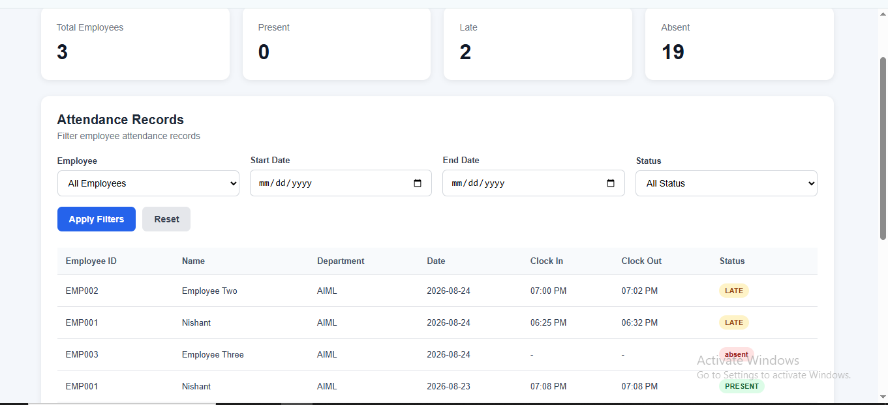
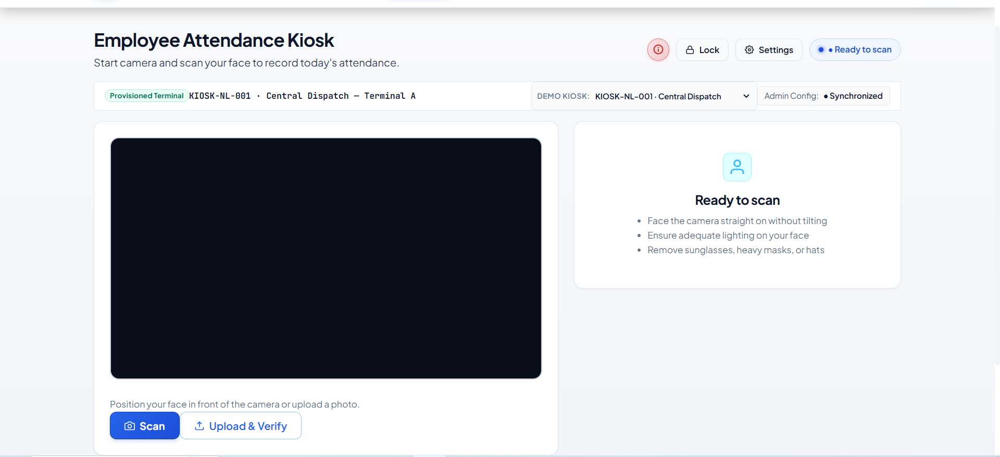

# AWS Serverless Attendance System with Facial Recognition

[](https://aws.amazon.com/)
[](https://aws.amazon.com/rekognition/)
[](https://www.python.org/)
[](https://developer.mozilla.org/)
[](LICENSE)

An enterprise-grade, event-driven, cloud-native attendance management platform built on AWS serverless architecture. The system replaces legacy biometric hardware and manual check-ins with automated facial recognition, real-time shift analytics, presigned S3 uploads, and automated daily absence auditing.

---

## Table of Contents
1. [Architecture Overview](#architecture-overview)
2. [Key Features](#key-features)
3. [System Architecture & Data Flow](#system-architecture--data-flow)
4. [AWS Infrastructure & Microservices Inventory](#aws-infrastructure--microservices-inventory)
5. [Database Schema Design](#database-schema-design)
6. [API Specification](#api-specification)
7. [User Interface & Dashboards](#user-interface--dashboards)
8. [Cost Estimation & Optimization Model](#cost-estimation--optimization-model)
9. [Deployment & Setup Guide](#deployment--setup-guide)
10. [Testing & Operational Verification](#testing--operational-verification)
11. [Future Roadmap](#future-roadmap)
12. [License & Acknowledgments](#license--acknowledgments)

---

## Architecture Overview

The system operates entirely on AWS Serverless services, ensuring zero server maintenance, auto-scaling capabilities, high availability, and pay-as-you-go cost management.



### Core Components
* **Frontend Tier**: Single-Page Web Applications hosted on **Amazon S3** (Web Kiosk for clocking in/out, and HR Management Dashboard for workforce oversight).
* **API & Security Tier**: **Amazon API Gateway (HTTP REST API)** with presigned S3 upload security, CORS policies, and **AWS IAM** execution roles.
* **Compute Tier**: **AWS Lambda** microservices executing face registration, image processing, attendance rules evaluation, weekly aggregation, and daily absence cron jobs.
* **AI & Computer Vision Tier**: **Amazon Rekognition** collection (`attendance-employees-collection`) performing facial feature vector indexing (`IndexFaces`) and similarity matching (`SearchFacesByImage`).
* **Database & Ledger Tier**: **Amazon DynamoDB** NoSQL tables providing single-digit millisecond latency for employee master data, daily attendance ledgers, and real-time verification logs.
* **Orchestration & Monitoring Tier**: **Amazon EventBridge Scheduler** for automated cron jobs, **Amazon CloudWatch** for structured log collection, and **AWS X-Ray** for end-to-end distributed tracing.

---

## Key Features

* **Touchless Facial Attendance**: Instant face matching via browser webcam or kiosk camera against indexed Rekognition face vectors with customizable similarity thresholds (80% - 90%).
* **Automated Clock-In / Clock-Out Logic**: Intelligently records the first scan of the day as `Clock-In` and subsequent scans as `Clock-Out`, auto-calculating total working hours.
* **Shift Rule & Grace Period Enforcement**: Evaluates scan timestamps against configured shift windows (e.g., 09:00 AM start with a 15-minute grace period) to automatically flag records as `PRESENT`, `LATE`, or `EARLY_CHECKOUT`.
* **Automated Daily Absence Processing**: Nightly scheduled cron triggered by EventBridge identifies employees without attendance logs for the day and auto-creates `ABSENT` records.
* **Idempotency & Concurrent Request Safety**: Handles redundant or rapid scan retries seamlessly without overwriting existing clock-in timestamps or corrupting ledger states.
* **Presigned S3 Image Upload Protocol**: Secure direct client-to-S3 file uploads using temporary presigned URLs (`upload_image` Lambda), preventing bottlenecking and reducing compute charges.
* **HR Workforce Analytics Dashboard**: Interactive visual portal providing key operational metrics (Attendance Rate, On-Time vs. Late count, Absent count, Department breakdown, and Weekly Work Hours reports).

---

## System Architecture & Data Flow

### 1. Employee Registration Flow


### 2. Attendance Verification & Scanning Flow


---

## AWS Infrastructure & Microservices Inventory

### S3 Storage Buckets
* **`serverless-attendance-system-nishant-2026`**: Primary bucket housing static web application assets, employee enrollment images (`registration-images/`), input attendance scans (`attendance-inputs/`), and exported report files (`reports/`).
* **`sa-hr-admin-face-2026`**: Auxiliary admin object storage bucket for HR backup archives.

### Lambda Microservices Inventory


| Lambda Function Name | Trigger Source | Runtime | Role & Description |
| :--- | :--- | :--- | :--- |
| `sa-register-employee` | API Gateway (`POST /register`) | Python 3.11 | Uploads reference face image, indexes face in Rekognition, writes master record. |
| `upload_image` | API Gateway (`POST /upload-url`) | Python 3.11 | Generates time-bound presigned S3 upload URLs for direct client uploads. |
| `sa-recognize-face` | S3 Event (`attendance-inputs/`) | Python 3.11 | Executes `SearchFacesByImage` against Rekognition collection. |
| `sa-process-attendance` | Asynchronous Lambda Call | Python 3.11 | Evaluates shift rules, grace periods, idempotency, and logs clock-in/out to DynamoDB. |
| `sa-admin-api` | API Gateway (`GET /employees`, `/attendance`) | Python 3.11 | Backend API serving workforce records, attendance history, and department filters. |
| `sa-weekly-analytics` | API Gateway (`GET /analytics`) | Python 3.11 | Aggregates weekly working hours, attendance rates, and team analytics. |
| `sa-daily-absence` | EventBridge Scheduler (Cron Daily) | Python 3.11 | Compares registered active workforce against daily logs and logs `ABSENT` records. |
| `sa-verification-result`| API Gateway (`GET /verification`) | Python 3.11 | Polls real-time face matching logs for kiosk confirmation feedback. |

---

## Database Schema Design



### 1. Employee Master Table (`serverless-attendance-employees`)
* **Partition Key (`PK`)**: `employee_id` (String, e.g., `EMP-1001`)

```json
{
  "employee_id": "EMP-1001",
  "full_name": "Sarah Jenkins",
  "department": "Engineering",
  "designation": "Cloud Solutions Architect",
  "rekognition_face_id": "c1f3b890-4a8e-49b2-a721-e8d1230987ab",
  "created_at": "2026-09-15T08:30:00Z",
  "status": "ACTIVE"
}
```

### 2. Attendance Ledger Table (`serverless-attendance`)
* **Partition Key (`PK`)**: `attendance_id` (String, e.g., `2026-10-01#EMP-1001`)
* **Global Secondary Index (GSI)**: `GSI_Date` (`date` Partition Key, `clock_in` Sort Key)

```json
{
  "attendance_id": "2026-10-01#EMP-1001",
  "employee_id": "EMP-1001",
  "employee_name": "Sarah Jenkins",
  "department": "Engineering",
  "date": "2026-10-01",
  "clock_in": "2026-10-01T08:52:14Z",
  "clock_out": "2026-10-01T17:05:30Z",
  "status": "PRESENT",
  "face_match_confidence": 98.42,
  "total_hours": 8.22,
  "updated_at": "2026-10-01T17:05:30Z"
}
```

### 3. Verification Audit Table (`serverless-verification-results`)
* **Partition Key (`PK`)**: `request_id` (String)

```json
{
  "request_id": "req-984210-abc",
  "timestamp": "2026-10-01T08:52:14Z",
  "image_s3_key": "attendance-inputs/scan_20261001_085214.jpg",
  "matched_employee_id": "EMP-1001",
  "similarity_score": 98.42,
  "verification_status": "MATCHED"
}
```

---

## API Specification



### Base Endpoint
`https://<api-id>.execute-api.us-west-1.amazonaws.com/prod`

### 1. Register Employee
* **URL**: `/register`
* **Method**: `POST`
* **Request Body**:
```json
{
  "employee_id": "EMP-1005",
  "full_name": "David Miller",
  "department": "Operations",
  "designation": "DevOps Engineer",
  "image_base64": "/9j/4AAQSkZJRgABAQAAAQABAAD..."
}
```
* **Response (201 Created)**:
```json
{
  "message": "Employee registered successfully",
  "employee_id": "EMP-1005",
  "face_id": "e4a29910-bc89-4321-9df1-123456789abc"
}
```

### 2. Request Presigned Upload URL
* **URL**: `/upload-url`
* **Method**: `POST`
* **Request Body**: `{"filename": "attendance_scan_1001.jpg"}`
* **Response (200 OK)**:
```json
{
  "upload_url": "https://serverless-attendance-system-nishant-2026.s3.amazonaws.com/attendance-inputs/attendance_scan_1001.jpg?X-Amz-Algorithm=...",
  "file_key": "attendance-inputs/attendance_scan_1001.jpg"
}
```

### 3. Fetch Attendance History
* **URL**: `/attendance?date=2026-10-01&department=Engineering`
* **Method**: `GET`
* **Response (200 OK)**:
```json
{
  "date": "2026-10-01",
  "total_records": 1,
  "data": [
    {
      "employee_id": "EMP-1001",
      "employee_name": "Sarah Jenkins",
      "department": "Engineering",
      "clock_in": "08:52 AM",
      "clock_out": "05:05 PM",
      "status": "PRESENT",
      "confidence": "98.4%"
    }
  ]
}
```

---

## User Interface & Dashboards

### 1. Employee Attendance Kiosk Interface
Touchless terminal application running on tablets/webcams allowing employees to scan their face in real time.



### 2. HR Attendance & Workforce Dashboard
Centralized portal for HR administrators featuring live attendance metrics, status distribution, workforce list, and registration modal.



### 3. Weekly Workforce Analytics Report
Aggregated analytics displaying working hours, punctuality trends, and department compliance.



---

## Cost Estimation & Optimization Model

A comprehensive cost model was conducted for the architecture across three organizational operating scales: **10 users/day**, **500 users/day**, and **5,000 users/day**.

### Monthly AWS List Price Breakdown (US-West-1)

| AWS Service Component | Pricing Basis | 10 Users/Day | 500 Users/Day | 5,000 Users/Day |
| :--- | :--- | :---: | :---: | :---: |
| **AWS Lambda** | $0.20/M req + $0.0000166667/GB-s | $0.006 | $0.31 | $3.08 |
| **Amazon API Gateway** | $3.50/M REST API calls | $0.004 | $0.21 | $2.10 |
| **Amazon Rekognition** | $0.001/image face search | $0.60 | $30.00 | $300.00 |
| **Amazon DynamoDB** | $0.125/M reads + $0.625/M writes | $0.002 | $0.08 | $0.83 |
| **Amazon S3 Storage** | $0.023/GB-mo + $0.005/1K PUTs | $0.003 | $0.16 | $1.55 |
| **Amazon CloudWatch** | $0.50/GB log ingestion | $0.005 | $0.23 | $2.30 |
| **AWS X-Ray** | $5.00/M traces (after 100K free) | $0.000 | $0.00 | $2.50 |
| **EventBridge Scheduler**| 14M invocations included free | $0.000 | $0.00 | $0.00 |
| **ESTIMATED TOTAL / MONTH**| **Gross List Price (Excl. Free Tier)** | **$0.62** | **$30.99** | **$312.36** |

### Compute Optimization Strategy (ARM64 / AWS Graviton2 Migration)
By transitioning Lambda function execution architectures from `x86_64` to `arm64` (AWS Graviton2), compute duration pricing is reduced by **20%**, offering substantial savings as invocation volume scales:

| Scale | Baseline Monthly Compute Cost | Modeled ARM64 Monthly Cost | Net Savings | Savings % |
| :--- | :---: | :---: | :---: | :---: |
| **10 Users/Day** | $0.620 | $0.619 | $0.001 | 0.20% |
| **500 Users/Day** | $30.99 | $30.93 | $0.062 | 0.20% |
| **5,000 Users/Day** | $312.36 | $311.74 | $0.620 | 0.20% |

---

## Deployment & Setup Guide

### Prerequisites
* **AWS CLI** configured with administrator access credentials (`aws configure`).
* **Python 3.11+** installed locally.
* **Node.js 18+** (Optional, if deploying SAM/CDK frameworks).

### Step 1: AWS Rekognition Collection Setup
Create the Amazon Rekognition face collection used to index employee faces:
```bash
aws rekognition create-collection \
  --collection-id attendance-employees-collection \
  --region us-west-1
```

### Step 2: DynamoDB Tables Provisioning
Create the required NoSQL tables:
```bash
# Employee Master Table
aws dynamodb create-table \
    --table-name serverless-attendance-employees \
    --attribute-definitions AttributeName=employee_id,AttributeType=S \
    --key-schema AttributeName=employee_id,KeyType=HASH \
    --billing-mode PAY_PER_REQUEST

# Attendance Ledger Table
aws dynamodb create-table \
    --table-name serverless-attendance \
    --attribute-definitions AttributeName=attendance_id,AttributeType=S \
    --key-schema AttributeName=attendance_id,KeyType=HASH \
    --billing-mode PAY_PER_REQUEST
```

### Step 3: S3 Bucket & Event Triggers Provisioning
```bash
aws s3 mb s3://serverless-attendance-system-nishant-2026 --region us-west-1
```

Configure S3 Bucket Notification to trigger `sa-recognize-face` on `attendance-inputs/` uploads:
```json
{
  "LambdaFunctionConfigurations": [
    {
      "LambdaFunctionArn": "arn:aws:lambda:us-west-1:123456789012:function:sa-recognize-face",
      "Events": ["s3:ObjectCreated:*"],
      "Filter": {
        "Key": {
          "FilterRules": [
            { "Name": "prefix", "Value": "attendance-inputs/" }
          ]
        }
      }
    }
  ]
}
```

### Step 4: EventBridge Scheduler Absence Rule
Create the daily midnight cron rule:
```bash
aws scheduler create-schedule \
    --name daily-absence-checker \
    --schedule-expression "cron(0 0 * * ? *)" \
    --target '{"Arn": "arn:aws:lambda:us-west-1:123456789012:function:sa-daily-absence", "RoleArn": "arn:aws:iam::123456789012:role/service-role/EventBridgeLambdaRole"}'
```

---

## Testing & Operational Verification

### Functional Verification Summary
| Test Case ID | Feature Tested | Input / Condition | Expected Outcome | Result |
| :---: | :--- | :--- | :--- | :---: |
| **TC-01** | Employee Registration | Valid metadata + sharp face image | Face indexed in Rekognition; record stored in DynamoDB | **PASS** |
| **TC-02** | Contactless Clock-In | Known registered employee scan | Recognized face (confidence > 80%); logged `Clock-In` | **PASS** |
| **TC-03** | Contactless Clock-Out | Second scan on same day | Updated record with `Clock-Out` & `Total Hours` | **PASS** |
| **TC-04** | Late Scan Rule | Scan timestamp past 09:15 AM | Attendance status flagged as `LATE` | **PASS** |
| **TC-05** | Unregistered Scan | Unindexed user face | Recognized as `UNKNOWN`; alert logged | **PASS** |
| **TC-06** | Daily Absence Job | Midnight cron trigger | Unmatched employees auto-marked `ABSENT` | **PASS** |
| **TC-07** | Concurrent Scan Retry | Multiple scans within 10 seconds | Idempotency guard prevents duplicate records | **PASS** |

---

## Future Roadmap

- [ ] **Multi-Factor Authentication (MFA)**: Geofencing validation alongside facial recognition.
- [ ] **Liveness Detection**: Anti-spoofing algorithms to prevent photo/video presentation attacks.
- [ ] **Leave & Shift Scheduling Module**: Native approval workflows for employee leave requests.
- [ ] **Slack / Teams Notifications**: Instant automated alerts for late arrivals or daily workforce summaries.

---

## License & Acknowledgments

This project is open-source under the **MIT License**.

Special thanks to **F13 Technologies** for guidance and technical support throughout the implementation of this AWS Serverless solution.
